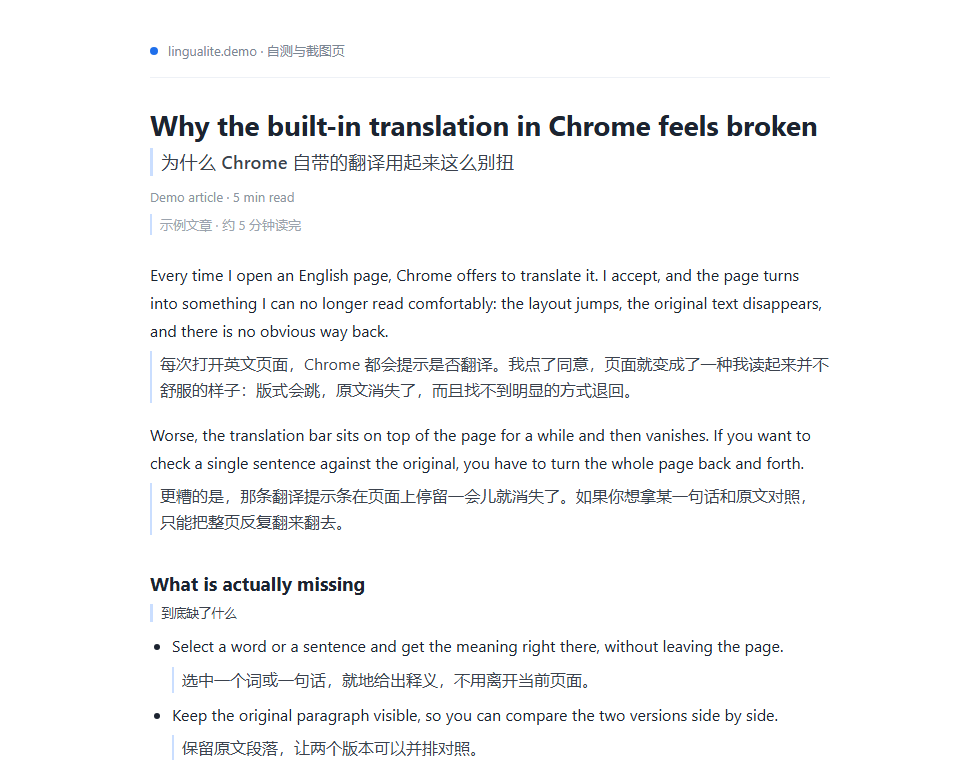
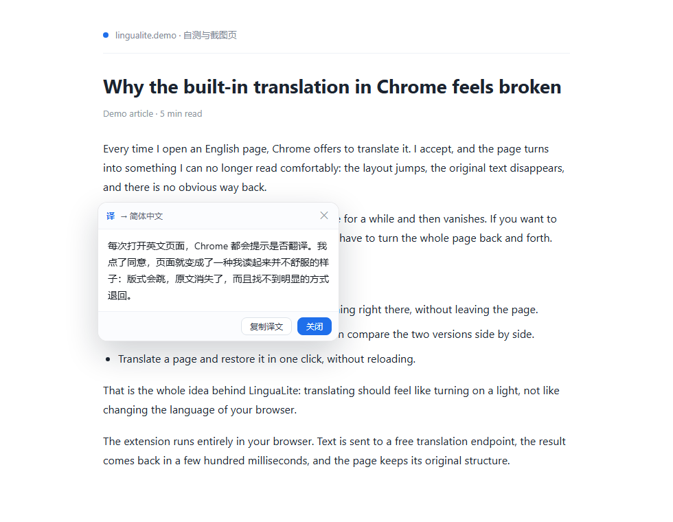

# 轻译 LinguaLite

一个不依赖任何 API Key、装好就能用的 Chrome 翻译插件。针对 Chrome 自带翻译最难受的三点做了重做：

| Chrome 自带翻译 | 轻译 |
| --- | --- |
| 整页替换，原文消失，想对照只能来回切 | **双语对照**：译文插在每段原文下方，原文一个字不动 |
| 只能翻整页，查一个词也要动全页 | **划词即译**：选中就有蓝色「译」按钮，点一下出卡片，Esc 关掉（嫌挡视线可一键关掉） |
| 只想懂其中几段，却整页被替换 | **局部双语对照**：选中这几段右键，只给它们加译文，其余页面不动，再点一次还原 |
| 翻译栏一会儿就消失，还原要重新加载 | **Alt+T 一键开 / 一键还原**，不用刷新页面 |




## 安装（约 30 秒）

1. 打开 `chrome://extensions/`（地址栏输入即可）
2. 右上角打开 **开发者模式**
3. 点 **加载已解压的扩展程序**，选择本文件夹（`浏览器翻译插件`，含 `manifest.json` 的那一层）
4. 装好后建议刷新一下已经开着的标签页（新开的页面自动生效）

> 装完可以在地址栏右侧的拼图图标里把「轻译」固定到工具栏，方便随时点开。

## 怎么用

- **划词翻译**：选中任意文字 → 出现蓝色「译」→ 点它 → 卡片里出译文，可一键复制。`Esc` 或点空白处关闭。
- **整页双语**：按 `Alt+T`，或点插件图标 → 「翻译本页」。每段原文下面出现译文；再按一次 `Alt+T` 还原。
- **局部双语对照**：选中一个或多个段落 → 右键 →「双语对照翻译」。只给你选的那几段加译文，页面其它地方一字不动；对同样的选区再点一次即还原。
- **右键菜单只有一项**：「双语对照翻译」。有选区时译选中的段落，没有选区时整页双语 / 再点一次还原——同一个入口，按你选没选文字自动判断。
- **面板里直接翻**：点插件图标，在上方输入框粘贴长文本，`Ctrl+Enter` 翻译。
- **中英自动识别**：默认「目标」就是**自动**——输入中文自动译英文，输入英文自动译简体中文（日、韩、俄等其它语言一律译中文），不用每次手动切语言。输入框下方会实时显示这次的方向，例如 `自动识别 中文 → English`。
- **蓝色「译」按钮可关**：面板里「划词显示『译』按钮」关掉后，划词不再出现任何气泡，页面一点不被打扰，改用右键菜单翻译。按钮本身贴着选区右下角，正好在鼠标松开的位置。
- **自动划词**（可选）：面板里打开「划词自动翻译」，选中文字就直接弹卡片，连点都不用点。
- **目标语言**：默认「自动（中↔英）」，也就是中文→英文、其它语言→简体中文；要固定方向就在面板里选繁体、英、日、韩、法、德、西、俄等 18 种里的某一种。

三种划词方式按需选一个，互不冲突：

| 面板开关 | 选中文字后 |
| --- | --- |
| 按钮开 + 自动关（默认） | 选区右下角出现蓝色「译」，点它出译文 |
| 按钮关 + 自动关 | **什么都不出现**，右键「双语对照翻译」 |
| 自动开 | 直接弹译文卡片 |

## 中英自动识别是怎么判的

判定完全在本地做，不发任何请求，粘贴几万字也是毫秒级：

| 输入 | 判为 | 译成 |
| --- | --- | --- |
| 汉字占比 ≥ 20%（`用 Chrome 打开这个页面` 也算中文） | 中文 | 英文 |
| 出现假名 | 日文 | 简体中文 |
| 谚文 / 西里尔 / 阿拉伯 / 泰文占多数 | 对应语言 | 简体中文 |
| 其余（拉丁字母） | 英文 | 简体中文 |

规则只写在 `lang.js` 一个文件里，面板、划词卡片、整页翻译都调它：方向先算好，再随消息把目标语言交给后台。

几点说明：

- **整页只判一次**（取前 4000 字做样本），不会出现「上半页译成中文、下半页译成英文」。
- **中文页面点「翻译本页」会译成英文**，这就是「自动」的定义；想译别的语言，把面板里的「目标」改成具体语种即可。
- 中英混排略偏向中文：「这个 API 的 timeout 设成 30 秒」会被判为中文 → 英文。

## 翻译通道（全部免费、无需注册）

插件内置三条通道，默认「自动」：按 **微软 → 腾讯 → 谷歌** 的顺序尝试，哪条通就用哪条，全都不通才会报错。

| 通道 | 端点 | 说明 |
| --- | --- | --- |
| 微软 | `edge.microsoft.com/translate/translatetext` | Edge 浏览器内置翻译所用的免鉴权端点。注意：老教程里的 `/translate/auth` 取票接口已于 2026-07 下线，本插件用的是单步端点，无需 token |
| 腾讯 | `transmart.qq.com/api/imt` | 腾讯交互翻译的接口，**国内直连最稳** |
| 谷歌 | `translate.googleapis.com/translate_a/single` | 备用；国内网络通常不通，只在代理/境外环境下有效 |

实测（本机，2026-11）：微软 ~0.5s、腾讯 ~0.5s、谷歌（走代理）~10s。三条都能返回批量结果，插件会自动分批（每次 20 段 / 4500 字符）以适配长文章。

如果某天某条通道失效，插件会自动落到下一条，不会白屏；也可以在面板「通道」里手动钉住一条来验证。

## 顺便关掉 Chrome 自带的翻译打扰

`chrome://settings/languages` → 「使用 Google 翻译」相关选项 → 关掉「询问是否翻译此类语言的网页」。之后就交给轻译，不会再被顶部那条翻译栏打断。

## 常见问题

**在面板里关掉了「划词显示『译』按钮」，页面上的蓝气泡还是照样出现？**

这是浏览器的机制问题，不是开关没生效：**扩展更新后，已经打开的标签页里跑的还是旧版脚本**，Chrome 不会给已打开的页面重新注入内容脚本。

1.1.1 起已经自动处理：打开一次插件面板，就会把当前页的脚本升到最新版（不会出现两个气泡）；如果某类页面不允许注入，面板顶部会弹一条黄色提示，点「刷新页面」即可。

**为什么第一次装完要刷新页面？**
同上——装扩展之前就已经打开的页面没有注入过脚本。

## 隐私

- 不收集任何数据，没有统计、没有账号、没有远程配置。
- 只有你主动选中或主动整页翻译时，对应的文字才会发给你选中的翻译服务（微软 / 腾讯 / 谷歌）。
- 所有设置只存在本地 `chrome.storage.local`。

## 译文为什么不会把原文挤歪

译文是个块级元素，直接塞进原文元素里在普通段落中没问题；但很多站点（GitHub 就是典型）
把「标签 + 计数 + 时间」放在固定高度的 flex 行里，译文一进去就变成同一行里的第三个盒子，
原文和数字被挤歪、胶囊被撑成两行。所以插入前会先算落点：

| 原文所在的位置 | 译文放哪 |
| --- | --- |
| 普通段落 / 标题 / 列表项 / 表格单元格 | 就放在原文里面（段落下方新起一行） |
| 固定高度的 flex 行、网格、行内元素、徽标胶囊 | 提到该行**下面**，整行只出一行译文 |
| 导航栏（`nav`）、按钮、工具栏、菜单、搜索框 | **不翻**：这些是一行高的控件，翻了只会挤 |
| `sr-only`（只给屏幕阅读器看的隐藏标题）、`opacity:0` | 不翻，否则译文会在页面上凭空堆一堆碎片 |

同一行里的多个小格子（头像组 + 提交信息 + 短哈希 + 时间）会合并成一段一起翻，
不会碎成好几条。

## 已知限制

- `chrome://`、Chrome 应用商店等系统页面不允许扩展注入，会提示「不支持此页」。
- 无限滚动页面（微博、Reddit 等）后来加载出来的新段落不会自动翻，再点一次「翻译本页」即可（已翻的不会重复）。
- PDF、canvas 内绘制的文字无法翻译。
- 极短的混合输入（例如「Hello 你好」）按字符占比判，可能偏向中文；只有数字和符号时无法判定，按「译简体中文」处理。
- 代码块（`pre` / `code`）、输入框内容会被跳过，避免翻坏代码。

## 目录结构

```
浏览器翻译插件/
├── manifest.json      # MV3 配置
├── lang.js            # 语种判定（中→英 / 其它→中），面板与内容脚本共用
├── background.js      # 三条翻译通道 + 右键菜单 + 快捷键
├── content.js         # 划词气泡 / 译文卡片 / 整页双语（Shadow DOM 防样式污染）
├── content.css        # 注入页面的译文块样式
├── popup.html/css/js  # 工具栏面板
├── icons/             # 图标（由 tools/make_icons.py 纯 Python 生成）
├── demo/demo.html     # 自测页：?hash 控制场景（#bubble / #card / #page）
├── test/
│   ├── e2e.html       # 划词 / 卡片 / 局部对照的端到端用例
│   └── flex.html      # 布局回归页：flex 行、网格、徽标、截断标题
└── tools/
    ├── make_icons.py     # 重新生成图标
    ├── test_engine.js    # node tools/test_engine.js 直接测三条通道
    ├── check_layout.js   # node tools/check_layout.js 无头 Chrome 跑布局回归
    └── check_github.js   # node tools/check_github.js [url] 在真实页面上查译文压字
```

## 想改点什么

- 换默认目标语言：`background.js` / `content.js` / `popup.js` 里的 `DEFAULTS.to`（现在默认 `'auto'`，改成 `'zh-Hans'` 就是永远译中文）。
- 改自动识别的判定阈值：`lang.js` 里的 `CJK_THRESHOLD`（默认 0.2，汉字占比超过两成算中文）。
- 卡片宽度：`content.js` 里 `.card{width:352px}`。
- 改快捷键：`chrome://extensions/shortcuts`，不用改代码。

## 许可证

MIT License，详见 [LICENSE](LICENSE)。

## 参与

提 Issue / PR 都欢迎。改代码前建议先跑 `node tools/test_engine.js`（三条翻译通道）和 `node tools/check_layout.js`（布局回归），确认没把译文插坏页面。
